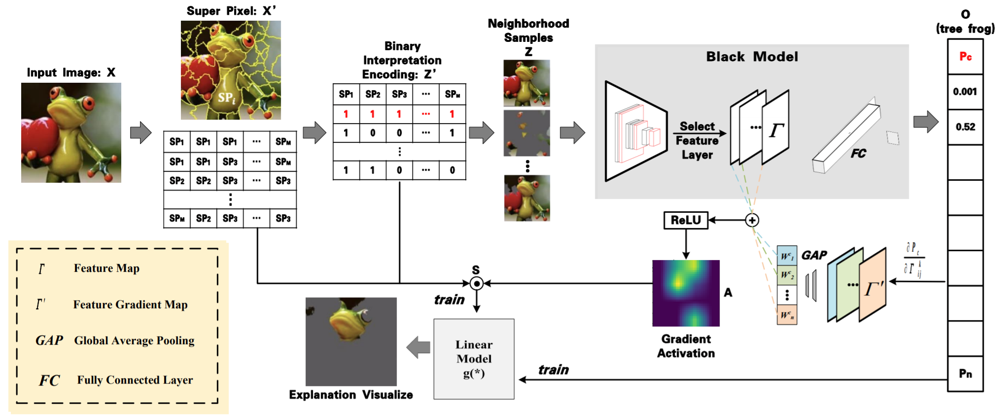

# GradLIME

**GradLIME: A CNN Local Interpretation Model Based on Feature Gradient Activation**

- **Authors:** Jinwei Zhao (zhaojinwei@xaut.edu.cn), Jiedong Liu (1041674453@qq.com), Zhenghao Shi, Yu Liu, Majid Habib Khan, Wei Wang, Minhui Zhu, Xinhong Hei* (heixinhong@xaut.edu.cn)
- **Affiliation:** Xi'an University of Technology, China
- **Paper status:** under review at *Scientific Reports* ([link and DOI will be added upon publication](https://doi.org/10.21203/rs.3.rs-7004733/v1))
- **Contact:** corresponding author Xinhong Hei, heixinhong@xaut.edu.cn

This repository provides the complete experimental code, environment configuration, and running instructions for academic replication and secondary research.

---

## Overview

| GradLIME Interpretation Model |
|:-----------------------------:|
|  |

GradLIME is a local attribution method for Convolutional Neural Networks (CNNs) built upon Local Interpretable Model-agnostic Explanations (LIME). GradLIME augments the perturbation-based local linear model of LIME with feature gradient activation computed from a convolutional layer of the network, so that the fitted local model is informed both by the perturbation responses of the black-box model and by the channel-wise importance derived from its internal feature space. The resulting explanation assigns a signed weight to each superpixel, identifying the image regions that support or oppose an individual prediction.

Experiments on the ImageNet validation set with six CNN architectures provide qualitative illustrations and a quantitative evaluation using the Quantus toolkit. Relative to LIME and a range of attribution baselines, the proposed activation weighting yields consistent improvements on the correlation-type faithfulness metrics while retaining a comparable level of explanation complexity, at a runtime overhead of about 39% over LIME that is incurred once per image and is independent of the number of neighbourhood samples.

---

## Repository structure

```
GradLIME/
├── GradLIME.py              # Quick demo: GradLIME visual explanation of one image (with Grad-CAM overlay)
├── GradLIME_w_f.py          # Superpixel-weight relationship curves (paper Fig. 3)
├── my_difmodel.py           # Visual explanations across six CNN architectures (paper Fig. 2)
├── my_diflayer.py           # Effect of the activation layer on the explanation (paper Fig. 4)
├── MyFaithfulness.py        # Quantitative faithfulness evaluation, 300 images, 12 methods (paper Tables 3-4)
├── MyComplexity.py          # Quantitative complexity evaluation, 300 images, 12 methods (paper Tables 5-6)
├── my_metrics.py            # Unified superpixel-level metric protocol used by the two scripts above
├── abl_common.py            # Shared base module for all ablation scripts
├── A1c_cam_mode.py          # Ablation A1: role of the activation (regression input vs. post-processing)
├── A2_layer.py              # Ablation A2: activation layer (layer1..layer4 / multi-layer average)
├── A3_nsamples.py           # Ablation A3: number of neighbourhood samples N
├── A4_segmentation.py       # Ablation A4: segmentation algorithm and superpixel count
├── A5_masking.py            # Ablation A5: masking fill strategy
├── A6_kernel.py             # Ablation A6: kernel width sigma
├── A7_relu_norm.py          # Ablation A7: activation post-processing (ReLU / normalisation)
├── A8_explanation_length.py # Ablation A8: explanation length K
├── A9_runtime.py            # Ablation A9: wall-clock runtime vs. LIME
├── lime/                    # MODIFIED LIME package (GradLIME core: lime_base_my.py, lime_image_my.py)
├── pytorch_grad_cam/        # MODIFIED pytorch-grad-cam package (feature gradient activation)
├── quantus/                 # Quantus toolkit 0.5.3 (evaluation backend)
├── imagenet/                # ImageNet class-index mapping (imagenet_class_index.json)
├── test_img/                # Sample images for the quick demo (included)
├── ImageNet2012/val100/     # 100-image ablation sample set (included)
├── ImageNet2012/val300/     # 300-image quantitative sample set (included)
├── result/                  # Archived outputs of the 300-image quantitative evaluation
├── results_ablation/        # Archived outputs of ablation studies A1-A9
├── output/                  # Figures produced by the demo scripts
├── DemoImage/               # Images used in this README
└── requirements.txt
```

> **Note:** `lime/`, `pytorch_grad_cam/`, and `quantus/` are **modified, bundled copies**. Do not replace them with the PyPI versions — the scripts import these local packages.

---

## Environment setup

Anaconda is recommended.

```bash
conda create -n GradLIME python=3.8
conda activate GradLIME

# 1) Install PyTorch FIRST, matched to your CUDA version.
#    CUDA 11.8 (used in the paper):
pip install torch==2.1.2 torchvision==0.16.2 --index-url https://download.pytorch.org/whl/cu118
#    CPU only:
#    pip install torch==2.1.2 torchvision==0.16.2 --index-url https://download.pytorch.org/whl/cpu

# 2) Install the remaining dependencies
pip install -r requirements.txt
```

Reference hardware used in the paper: AMD Ryzen 7 5800H, NVIDIA GeForce RTX 3060 Laptop GPU, PyTorch (CUDA 11.8). All scripts also run on CPU (`--device cpu`), at correspondingly longer runtimes.

---

## Data preparation

| Dataset | Status | Used by |
|---|---|---|
| `test_img/` | included | quick demo scripts |
| `ImageNet2012/val100/` | included (100 images) | ablation studies A1–A9 |
| `ImageNet2012/val300/` | **must be prepared by the user** | quantitative evaluation (MyFaithfulness / MyComplexity) |

**Preparing `ImageNet2012/val300/`:** download the ILSVRC2012 validation set (see e.g. https://blog.csdn.net/weixin_47160526/article/details/132037269 for download and organisation instructions) and arrange the images in class folders under `ImageNet2012/val300/`:

```
ImageNet2012/val300/
├── n01440764/
│   ├── ILSVRC2012_val_00000293.JPEG
│   └── ...
├── n01443537/
└── ...
```

The evaluation scripts iterate over the class folders in sorted order, take the first `--num-classes` classes and up to `--num-images-per-class` images per class, and (with `--require-correct`) retain only images whose ResNet-18 top-1 prediction matches the folder label, yielding the 300-image evaluation set used in the paper. The same protocol with `--num-classes 70` yields the 100-image ablation set already included in `ImageNet2012/val100/`.

---

## Quick start

### 1. Clone the repository

```bash
git clone https://github.com/LiuJiedong-Coder/GradLIME.git
cd GradLIME
```

### 2. Run the demo (works out of the box on `test_img/`)

```bash
python GradLIME.py
```

This explains the ResNet-18 prediction for `test_img/lion_tiger.png`: it prints the top-1 prediction, shows the Grad-CAM overlay, and then the GradLIME explanation (green regions support the prediction, red regions oppose it). To explain your own image, edit `img_path` in the script.

Superpixel-weight relationship curves (paper Fig. 3):

```bash
python GradLIME_w_f.py
```

Visual explanations across six CNN architectures (paper Fig. 2):

```bash
python my_difmodel.py
```

Effect of the activation layer (paper Fig. 4):

```bash
python my_diflayer.py
```

### 3. Change the black-box model

The demo scripts support the following models and recommended activation layers (increasing parameter count):

```python
model_mob    = models.mobilenet_v2(pretrained=True)   # target: model_mob.features[18]
model_alex   = models.alexnet(pretrained=True)        # target: model_alex.features[10]
model_google = models.googlenet(pretrained=True)      # target: model_google.inception5b
model_res18  = models.resnet18(pretrained=True)       # target: model_res18.layer4[-1]  (same for resnet50)
model_inc    = models.inception_v3(pretrained=True)   # target: model_inc.Mixed_7c
model_dense  = models.densenet121(pretrained=True)    # target: model_dense.features[10]  
```

---

## Reproducing the quantitative evaluation (paper Tables 3–6)

Requires `ImageNet2012/val300/` (see Data preparation). Twelve explanation methods (LIME, GradLIME, IG, Saliency, Gradient SHAP, Input×Gradient, Deconvolution, Kernel SHAP, LRP, Gradient, and two random-attribution controls) are evaluated with five faithfulness metrics and three complexity metrics under a unified superpixel-level deletion protocol, with paired Wilcoxon signed-rank tests (Holm–Bonferroni corrected) and Cohen's d.

```bash
# Faithfulness metrics: Correlation, Estimate, Monotonicity, IROF, RegionPerturbation
python MyFaithfulness.py --require-correct --out-dir results/faithfulness300-k20-1000

# Complexity metrics: Complexity, Sparseness, EffectiveComplexity
python MyComplexity.py --require-correct --out-dir results/complexity300-k20-1000
```

Key parameters (defaults reproduce the paper): `--num-samples 1000` (N), `--num-features 20` (K), `--random-seed 500`, `--metric-backend superpixel`, `--device cuda`. Adjust the sample size to your hardware, e.g. `--num-classes 20 --num-images-per-class 5` for a quick run.

Each run writes three files per metric family into `--out-dir`: `*_scores.csv` (per-image values), `*_summary.csv` (mean ± std per method), and `*_paired_tests.csv` (paired tests of every method against GradLIME). The outputs reported in the paper are archived in `result/faithfulness300-k20-1000/` and `result/complexity300-k20-1000/`.

---

## Reproducing the ablation studies (paper Table 7)

All ablations run on the included `ImageNet2012/val100/` set (100 correctly classified images) under the reference configuration, and report the paired difference and Cohen's d of each variant against the reference:

```bash
python A1c_cam_mode.py          # A1: role of the feature gradient activation
python A2_layer.py              # A2: activation layer
python A3_nsamples.py           # A3: number of neighbourhood samples N
python A4_segmentation.py       # A4: segmentation algorithm / superpixel count
python A5_masking.py            # A5: masking fill strategy
python A6_kernel.py             # A6: kernel width sigma
python A7_relu_norm.py          # A7: ReLU / normalisation post-processing
python A8_explanation_length.py # A8: explanation length K
python A9_runtime.py            # A9: wall-clock runtime vs. LIME
```

Outputs (`*_scores.csv`, `*_paired.csv`, `*_summary.txt`) are written to `results_ablation/<study>/`. The outputs reported in the paper are archived under the same directory.

---

## Default experimental configuration

The reference configuration below corresponds to Table 2 of the paper and is shared by the quantitative evaluation and all ablations:

| Item | Setting |
|---|---|
| Black-box model | ResNet-18 (torchvision, pretrained on ImageNet) |
| Activation layer | last convolutional layer (`layer4[-1]`) |
| Segmentation | quickshift (kernel size 4, max distance 200, ratio 0.2) |
| Neighbourhood samples N | 1000 |
| Explanation length K | 20 superpixels |
| Kernel width σ | 0.25 (cosine distance on binary codes, squared Gaussian kernel) |
| Masking fill | black (hide_color = 0) |
| Surrogate fitting | weighted least squares → Top-K selection → refit |
| Random seed | 500 |
| Evaluation sample | 300 / 100 correctly classified ImageNet validation images |

Runtime on the reference hardware: GradLIME 6.663 ± 0.314 s/image, LIME 4.786 ± 0.236 s/image (N = 1000; the overhead is incurred once per image and is independent of N).

---

## Citation

If you use this code in your research, please cite our paper:

```bibtex
@article{zhao2026gradlime,
  title   = {GradLIME: A CNN Local Interpretation Model Based on Feature Gradient Activation},
  author  = {Zhao, Jinwei and Liu, Jiedong and Shi, Zhenghao and Liu, Yu and Khan, Majid Habib and Wang, Wei and Zhu, Minhui and Hei, Xinhong},
  journal = {Scientific Reports},
  note    = {under review},
  year    = {2026}
}
```

---

## FAQ

1. **Q: `ModuleNotFoundError: lime` / `pytorch_grad_cam` / `quantus`?**
   A: Run the scripts from the repository root so that the bundled (modified) packages are found. Do **not** install `lime`, `grad-cam`, or `quantus` from PyPI — the local copies contain the GradLIME implementation and the superpixel-level metric protocol.

2. **Q: The dataset download fails.**
   A: Check your network or use a mirror; you may also contact the authors for an alternative link. Only `ImageNet2012/val300/` needs to be prepared manually — the demo images and the 100-image ablation set are included.

3. **Q: CUDA / GPU errors.**
   A: Make sure the installed PyTorch build matches your CUDA version (see Environment setup). All scripts also run on CPU with `--device cpu`.

4. **Q: Can I use a custom model or modify the explanation method?**
   A: Yes. The GradLIME core lives in `lime/lime_base_my.py` and `lime/lime_image_my.py`; the feature gradient activation is computed through `pytorch_grad_cam/`. For custom evaluation metrics, see `my_metrics.py`.

---

## References

- Ribeiro et al., *"Why Should I Trust You?": Explaining the Predictions of Any Classifier*, KDD 2016. https://arxiv.org/abs/1602.04938
- Selvaraju et al., *Grad-CAM: Visual Explanations from Deep Networks via Gradient-based Localization*, ICCV 2017. https://arxiv.org/abs/1610.02391
- Hedström et al., *Quantus: An Explainable AI Toolkit for Responsible Evaluation of Neural Network Explanations and Beyond*, JMLR 24(34), 2023. https://jmlr.org/papers/v24/22-0142.html
- Gildenblat et al., *pytorch-grad-cam*. https://github.com/jacobgil/pytorch-grad-cam

## License

See [LICENSE](./LICENSE).
